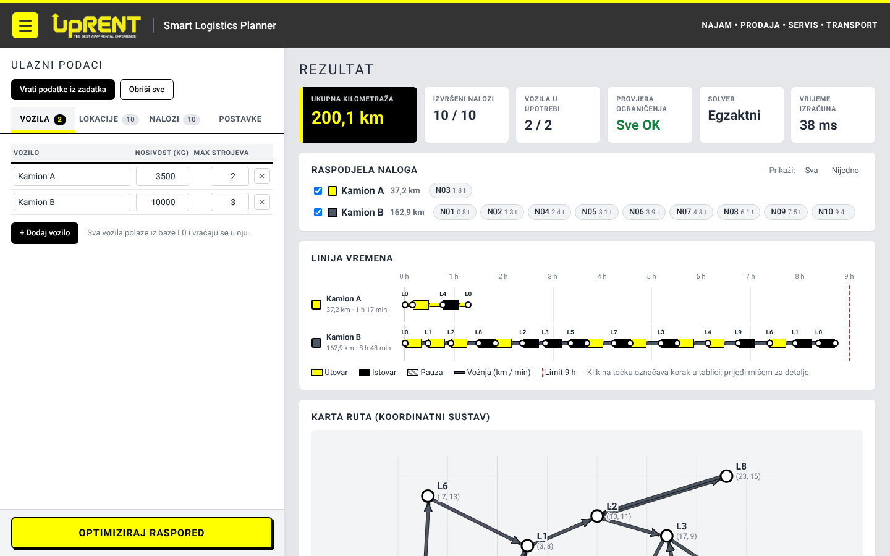

# UP RENT – Smart Logistics Planner

Prototip web-aplikacije koja raspoređuje transportne naloge radnih strojeva na kamione Up Renta i za svaki kamion određuje optimalan redoslijed preuzimanja i isporuka, uz najmanju ukupnu kilometražu.

**Live demo:** https://uprenttest.vercel.app/



## Rezultat za zadane podatke

| Tumačenje limita od 9 h | Raspored | Ukupno |
|---|---|---|
| **Vožnja + utovar/istovar** (zadana pretpostavka) | Kamion A: N03 (37,2 km, 1 h 17 min) · Kamion B: ostalih 9 naloga (162,9 km, 8 h 43 min) | **200,1 km** |
| Samo vožnja / bez limita | Kamion B: svih 10 naloga (182,2 km, ali 9 h 42 min ukupnog rada) | 182,2 km |

Rješenje je **dokazivo optimalno**: solver je egzaktan (bez heuristike). Rezultat je nezavisno potvrđen Python implementacijom i usporedbom s brute force pretragom. Detalji su u [docs/OPTIMIZACIJA.md](docs/OPTIMIZACIJA.md).

## Pokretanje

Potrebno: [Node.js](https://nodejs.org/) 20 ili noviji.

```bash
npm install      # instalacija ovisnosti
npm run dev      # razvojni server na http://localhost:5173
npm test         # testovi (Vitest)
npm run build    # produkcijski build u dist/
```

Nezavisna provjera rezultata u Pythonu (bez ovisnosti):

```bash
python3 tools/reference_check.py
```

## Funkcionalnosti

- **Prikaz i uređivanje ulaznih podataka:** vozni park, lokacije, strojevi i nalozi. Nalozi se mogu dodavati i uklanjati, a jedan klik vraća podatke iz zadatka.
- **Automatska raspodjela naloga** na kamione i **redoslijed obilaska** za svaki kamion.
- **Poštivanje svih ograničenja:**
  - nosivost (kg) i broj strojeva u svakom trenutku
  - preuzimanje prije isporuke, i to istim kamionom
  - polazak i povratak u bazu
  - dnevni limit od 9 h
- **Prekidač za tumačenje limita od 9 h:** vožnja + utovar/istovar, samo vožnja, ili bez limita.
- **Rezultat po kamionu:**
  - redoslijed lokacija i radnje (preuzimanje ili isporuka)
  - opterećenje nakon svake radnje (kg i broj strojeva)
  - dionica i kumulativni km, kumulativno vrijeme
  - ukupna kilometraža i broj izvršenih naloga
- **Ukupna kilometraža** oba kamiona i **karta ruta** (SVG).
- **Jasna upozorenja** za naloge koje nije moguće izvršiti, s razlogom (npr. stroj teži od nosivosti svih kamiona ili nalog ne stane u radni dan).
- **Nezavisni validator** koji nakon svake optimizacije ponovno provjerava sva pravila i prikazuje "Provjera ograničenja: Sve OK".

## Struktura

```
src/
  solver/              # čista TypeScript logika, bez Reacta
    solver.ts          # egzaktni solver (DP + raspodjela)
    validatePlan.ts    # nezavisna provjera poslovnih pravila
    validateInput.ts   # provjera ulaznih podataka
    distance.ts        # euklidska udaljenost, zaokružena na 0,1 km
    types.ts
    solver.test.ts     # testovi poslovnih ograničenja i optimalnosti
  data/defaultData.ts  # podaci iz zadatka
  components/          # React UI
tools/reference_check.py   # nezavisna Python provjera
docs/                      # dokumentacija za predaju
```

## Testovi

`npm test` pokreće 41 test case:

| # | Poslovno pravilo | Što se provjerava |
|---|---|---|
| 1 | Nosivost i broj strojeva | U nijednom koraku nijedan kamion ne premašuje kg ni broj strojeva (sva 3 načina limita) |
| 2 | Preuzimanje prije isporuke, isti kamion | Svaki stroj je preuzet prije isporuke, isti kamion radi oboje, a svaki nalog je izvršen točno jednom ili prijavljen kao neizvršiv |
| 3 | Baza | Svaka ruta kreće iz L0 i vraća se u L0, prazna |
| 4 | Dnevni limit od 9 h | Zadani podaci daju 200,1 km i oba kamiona su unutar 9 h. Bez limita je 182,2 km. Uz limit od 2 h nalozi se prijavljuju kao neizvršivi, s razlogom |
| 5 | Neizvršivi nalozi | Stroj od 12.000 kg prijavljen je upozorenjem, a ostali nalozi su svejedno optimizirani. Neispravan unos daje jasnu grešku |
| 6 | Optimalnost | Na 25 nasumičnih instanci solver daje isti rezultat kao naivni brute force |
| 7 | Udaljenost | Euklidska, zaokružena na 0,1 km po dionici |

## Dokumentacija za predaju

- [Opis optimizacijske logike i pretpostavki](docs/OPTIMIZACIJA.md)
- [Osvrt na korištene AI alate i način provjere](docs/AI-OSVRT.md)
- [Utrošeno vrijeme](docs/VRIJEME.md)
